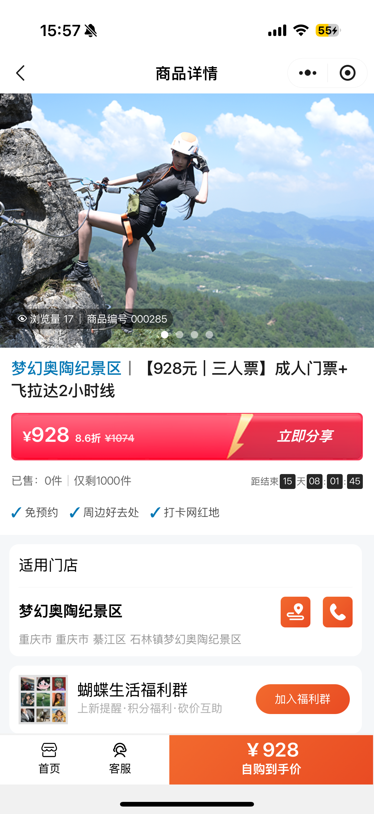
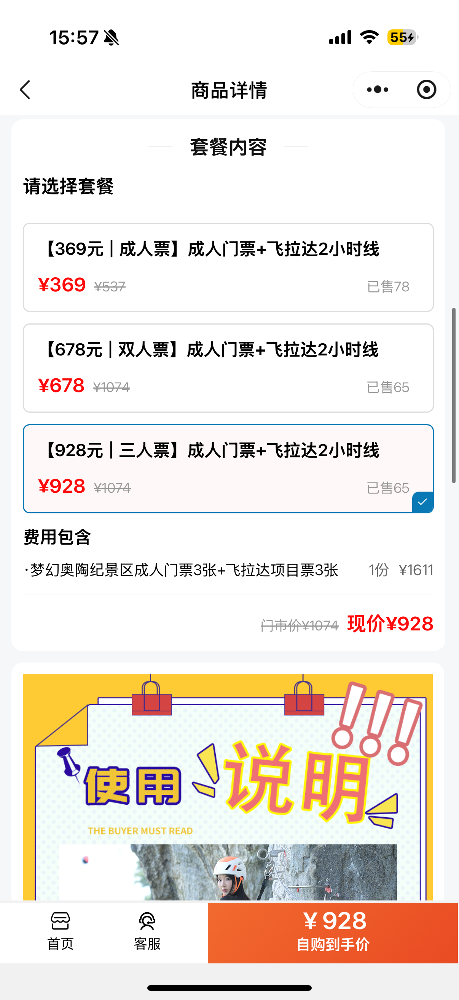

# 蝴蝶生活 × 快购｜商家合作说明

## 合作说明 · 2026.11｜让好生意，在微信里多一条出路

蝴蝶生活｜快购团队

### 把有吸引力的到店套餐，带到顾客日常使用的微信场景里。

我们协助商家完成套餐设计、商品展示、渠道推广协作与到店核销衔接，让顾客从“看到、感兴趣”走向“下单、到店消费”。

| 您最关心的事 | 我们的合作出发点 |
| --- | --- |
| 先花多少钱？ | 基础合作不收前置服务费；拍摄等增值服务自愿另购。 |
| 一单能留多少？ | 先确认结算价、费用承担和履约成本，再决定是否上线。 |
| 怎么判断值不值？ | 从少量套餐试售，核对到店、退款、结算与新客情况。 |

### 美团、抖音照常经营，多一个渠道做验证。

适合希望补充客源、利用闲时产能，或已经在微信发内容但尚未形成清晰购买路径的商家。

本册为合作沟通说明；具体渠道、服务、费用和结算周期以双方书面确认及实际准入为准。

## 01 · 市场与机会｜团购已经普及，经营开始比细节

商家需要关注的，是每一笔到店生意的质量。

| 公开信号 | 对商家的启示 |
| --- | --- |
| 抖音生活服务：2025年动销门店累计1519.8万，交易额同比增长59%。[2] | 内容能带动消费，但上架后仍要持续经营。 |
| 大众点评：2025年用户评价覆盖境内外902.9万家商家。[3] | 顾客已经习惯在线比较门店、价格与体验。 |

这些数据说明线上经营已具有较大规模，但不是全国商家覆盖率。平台口径不同，不能相加、排名或推算您所在城市的市场份额。

### 您是否也遇到这些情况？

有团购订单，却说不清扣完费用后还剩多少；内容一直在发，顾客却不知道在哪里买；高峰期忙不过来，工作日仍有空位；花钱买来第一单，后续很难再联系到顾客。

### 多一个入口，争取三种经营改善

补闲时：用限定时段和限量套餐承接空闲产能。
补触达：在微信内容与分享场景中接触潜在顾客。
补复购：在顾客自愿关注或加入社群后，持续提供有用信息。

以上是经营机会，不是销量保证；跨平台用户会重合，渠道订单不自动等于新客。

## 02 · 渠道选择｜三个渠道，各有适合的生意

以下是经营场景归纳，不是平台能力的排他划分。

| 维度 | 美团 / 大众点评 | 抖音 | 微信生态 + 蝴蝶生活 |
| --- | --- | --- | --- |
| 常见起点 | 找店、搜索、评价比较 | 短视频、直播激发兴趣 | 内容发现、朋友分享、社群推荐 |
| 经营重点 | 门店信息、评价、商品与转化 | 内容、主播、达人与投放协同 | 内容和社交触达、购买与履约衔接 |
| 成本核对 | 合同费用、营销产品、广告和人力 | 平台费用、达人、代运营、制作、广告和人力 | 约定结算差额或佣金、另购服务及履约成本 |
| 发挥价值 | 承接明确消费需求 | 展示体验，扩大兴趣触达 | 补充微信场景触达和后续沟通 |

### 不要只看“佣金几个点”

比较时，把同一观察期内的平台扣费、达人及服务费、广告费、制作费和人工投入放到一起，再看实际核销收入与最终回款。已包含在结算差额里的费用不能重复扣。

美团官方帮助页将商户通和推广通列为不同产品，推广通涉及独立预算设置。[4] 是否购买、收费多少要看具体合同，不能概括为所有商家必须支付年费。

代运营10%—15%、综合获客成本30%—40%不是本册采用的行业统一数据。请以门店自己的账单比较。

## 03 · 微信生态｜内容让人发现，分享让人靠近

微信值得测试，因为顾客的内容消费与日常沟通在这里相遇。

| 已披露指标 | 准确含义 |
| --- | --- |
| 14.18亿 | 截至2025年底，微信及WeChat合并月活跃账户数。[1] |
| 超过20% | 2025年视频号用户总使用时长同比增长。[1] |

前者是合并账户规模，不是独立自然人数，也不是蝴蝶生活能触达的人数；后者是总使用时长，不是团购成交增长。这些数据提供生态背景，门店效果仍需测试。

### 不同入口，承担不同任务

视频号短视频：展示环境、特色产品、消费场景。
视频号直播：集中讲清套餐与适用规则，回答购买疑问。
公众号文章与贴图：以图文说明体验、位置和优惠信息。
社群与朋友圈：由有信任关系的人分享，引发咨询和转发。

### 用消费场景选人，不用年龄标签猜人

亲子、聚餐、周末出游、休闲放松，比“某平台都是年轻人或中老年人”更有助于选套餐。具体看本地账号受众、咨询内容和核销顾客反馈。

本次未获得可核验的视频号直播、公众号贴图独立月活及本地购买人群数据，不将微信总量拆分或重复计算为渠道流量。

## 04 · 产品与路径｜蝴蝶生活怎样把关注接到消费

渠道是入口，交易路径要按实际条件分别确认。

发现与触达

↓

视频号短视频 / 直播 · 公众号文章 / 贴图 · 社群 / 朋友圈

↓

资格与链接能力确认

↓

路径A：允许的入口 → 蝴蝶生活商品页 → 下单 → 到店核销

↓

路径B：具备资格的商品卡 / 直播货架 → 对应交易平台 → 按该渠道规则核销

↓

订单核对 → 售后处理 → 按约定结算 → 顾客自愿再次关注

### 上线一份套餐，不等于自动同步所有渠道

我们先确认门店类目、账号资格、商品链接能力、实际发布账号和排期。每个渠道分别确定商品、价格、库存与核销方式；不同交易平台的订单和资金按各自规则处理。

### 公域和私域如何配合

公域内容帮助被更多潜在顾客发现；社群和朋友分享帮助顾客理解与决策；商品页说明套餐与规则；到店体验决定是否值得再次购买。后续联系建立在顾客自愿授权基础上。

本图为合作流程示意，并非全部渠道已打通的系统架构图。微信或抖音生态接入不代表腾讯、抖音为本项目提供效果担保。

## 05 · 真实界面｜顾客看得清，门店接得住

以下为现有产品截图示例，展示商品信息与套餐选择。

商品详情：主图、价格、优惠信息、适用门店、咨询与购买入口。
套餐选择：不同规格、费用包含和使用说明，帮助顾客购买前确认。

截图由项目方提供，非最新UI效果稿；截图价格、销量及库存仅代表当时页面展示，不作为销售业绩或本次报价。源码可见商品、订单与核销相关前端结构，正式合作须现场演示实际链路。

## 06 · 服务分工｜您做好到店体验，我们协作把商品推出去

把工作写清楚，比只承诺“帮您推广”更重要。

| 环节 | 快购 / 蝴蝶生活协作内容 | 商家配合 |
| --- | --- | --- |
| 选品 | 梳理卖点、套餐结构与推广适配 | 确认成本、履约能力和库存 |
| 上线 | 整理商品资料、规则与页面 | 提供资质、真实素材及发布授权 |
| 推广 | 协调约定渠道、账号及排期 | 确认文案与价格，不临时变更 |
| 到店 | 协助说明核销流程、处理订单问题 | 培训员工、保障接待与服务 |
| 复盘 | 核对订单、核销、退款与结算数据 | 提供到店反馈及可核验的新客信息 |

### 单独确认的增值服务

拍摄、剪辑、专项直播、广告投放等，只有双方确认报价和交付范围后才安排。基础合作不默认包含无限次拍摄、指定达人或保量直播。

### 每次试售都有一张执行单

写明负责人与联系方式、推广入口、素材交付日、上线日期、核销培训、售后响应与复盘日期。用实际发布记录和订单数据检查执行。

## 07 · 合作模式｜先把到手收益算清，再谈推广

基础合作不收前置服务费；按约定的有效核销结果结算。

| 确认事项 | 双方需要达成的一致 |
| --- | --- |
| 套餐与售价 | 商品内容、对外价格、限售数量、使用时段 |
| 商家结算价 | 每份有效核销后应结金额；税费、支付及渠道费用由谁承担 |
| 结算差额 / 佣金 | 选定适用模式，明确包含哪些服务，避免重复收费 |
| 结算时间 | 核销、售后状态、对账确认与付款周期写入合同 |
| 增值服务 | 自愿另购、单独报价，确认后才发生费用 |

采用结算价模式时，顾客支付价与商家结算价之间的差额，需要覆盖约定的渠道推广、分发服务等支出，并非全部是平台利润。采用佣金模式时，则写明基数、比例及其他费用，两种模式不默认叠加。

### 按结果付费，仍要把边界说清楚

未产生符合约定的有效核销，不收基础推广结算差额或佣金。已自愿购买并交付的拍摄等服务不因此自动退款；商家仍有备货、接待和履约投入。退款、异常核销、投诉订单及已结算后退款，按合同处理。

当前未确定统一结算周期；本册不承诺T+1或随时到账。具体收款主体、支付路径和对账流程在签约前确认。

## 08 · 一单账本｜卖得多之前，先看每单留得下多少

以下为计算示例，不是报价、收益承诺或真实商家案例。

| 每份有效核销 | 示例金额 |
| --- | --- |
| 顾客支付价 | 188元 |
| 商家约定结算价 | 150元 |
| 结算差额（假设已包含全部约定渠道服务费用） | 38元，约占支付价20.2% |
| 商家新增履约成本（食材 / 耗材 / 增量人工等） | 90元 |
| 单份贡献：150 − 90 | 60元 |

单份贡献还不是净利润：固定租金、常规工资、税费和另购服务等仍需考虑。若有额外费用，必须从结算收益中继续扣除。

### 销量要看核销，不看已售截图

假设售出100份，其中最终有效核销70份、退款20份、尚未使用10份：在示例条件下，70份应结款为10,500元，履约成本6,300元，贡献4,200元。未使用的10份尚不计入核销贡献，后续继续跟踪。

若另购500元拍摄服务且全部由本活动承担，则阶段贡献为3,700元；仅就这笔拍摄投入而言，至少需9份有效核销才能覆盖（500 ÷ 60向上取整）。

比较其他渠道时，也用相同套餐、时间窗和核销口径。老客从原渠道转来下单，应单列为迁移，不能全部计算为新增贡献。

## 09 · 团队与信任｜快购：把本地生活经验用在您的门店上

团队具备抖音官方服务商身份，长期关注本地生活运营。

我们了解商家在套餐、内容、达人协作和到店承接之间的实际难题，也希望把已有经验与资源用于微信渠道的合作。您可以要求现场核验服务商认证主体、有效状态与服务范围。

### 信任，落在三件可检查的事情上

| 看资质 | 核对快购对应的认证主体与签约公司；确认各主体的服务责任。 |
| --- | --- |
| 看产品 | 现场走一遍商品展示、下单、核销和售后流程；解释不同交易渠道的差异。 |
| 看执行 | 将本次负责人员、可用渠道、交付内容和复盘安排写进合作确认单。 |

### 案例要看完整过程

可用于判断效果的案例，应包含商家授权、时间范围、实际投入、支付订单、核销、退款和结算数据。只展示曝光量、销量截图或口头成果，无法说明商家最终赚了多少。

第一次合作，可以从您的一家门店、一到两份适合的套餐开始，先验证执行配合与实际到店，再决定扩大范围。

服务商身份与经验由快购方提供；认证法律主体全称及证明在洽谈时核验。该身份不代表微信官方授权，也不构成销量保证。

## 10 · 老板常问｜把合作中最重要的问题当面讲清

合理利润、清晰规则、可验证结果，是长期合作的前提。

### 必须比其他平台更便宜吗？

不要求简单追求全网最低价。我们更重视顾客能理解的性价比：可用错峰时段、限定数量、不同组合或加值服务做差异化，先守住您的结算底线。

### 为什么需要这么大的结算差额？

差额需要支持约定的推广和服务。激励有助于渠道愿意投入，但比例高不等于一定有效。请一起看费用包含项、执行内容和每单贡献；算不过账就调整套餐或先不做。

### 能不能低佣金，再单独买推广？

可以作为单独方案洽谈，但要写清固定预算、交付内容和效果不达预期时的处理方式。固定推广费发生后，不应再称为完全按结果付费。

### 什么时候结算？退款怎么办？

签约前明确结算触发条件、周期、对账截止日与异常订单处理。核销不等于即时到账；退款、争议及已结算后退款的调整规则都写在确认单里。

### 已经做了抖音和美团，还需要吗？

已有渠道继续经营。先用小范围验证微信是否带来新的有效触达、闲时到店或复购机会；如果只是老客换入口、利润反而下降，就不扩大。

## 11 · 启动试售｜先选一份套餐，把第一轮合作跑明白

建议方案：一家门店、1—2份套餐、14天销售观察。

| 阶段 | 双方完成的事 |
| --- | --- |
| 准备 | 核验类目与资质；选套餐、核算贡献；确定渠道和费用。 |
| 上线前 | 确认页面和规则；走通测试订单、退款与核销；培训员工。 |
| 销售观察 | 按执行单发布；跟踪咨询、支付、到店、退款及接待能力。 |
| 阶段复盘 | 核对有效核销、应结金额与异常；区分新客、老客和未知。 |
| 后续履约 | 14天不是券到期日；持续履约至约定有效期，处理售后和尾款。 |

### 扩大、调整，还是暂停？

扩大：单份贡献达到商家底线，服务稳定，新增客流有证据。
调整：咨询有但转化低，优先检查套餐、规则和内容；下单多但核销少，检查预约和有效期。
暂停新增销售：利润低于底线、接待超负荷、资质不匹配或结算出现异常。已售订单继续按约履约和售后。

### 今天先确认三件事

哪份套餐最值得推荐？每份结算至少多少您能接受？哪个时段最需要补充客人？

本页为建议试售安排，不是统一收费或销量政策。联系人、执行日期及目标在随附确认单中填写。

## 资料出处｜公开数据与阅读说明

检索日期：2026年11月15日；采用明确标注年份的数据，不称其为实时流量。

[1] 腾讯《2025全年及第四季度业绩公告》，2026-03-18。腾讯发布的新闻稿：微信及WeChat合并月活跃账户14.18亿；视频号2025年用户总使用时长同比增长超过20%。

https://www.prnewswire.com/apac/news-releases/tencent-announces-2025-annual-and-fourth-quarter-results-302717280.html

[2] 21世纪经济报道，2025-12-30，转述抖音生活服务年度总结。动销门店为累计口径，不等于年度活跃商家。

https://m.21jingji.com/article/20251230/herald/98d64802e208a7d6d67476daf5e25906_zaker.html

[3] 美团《2025企业社会责任报告》，数说美团第08—09页。采用评价覆盖商家规模，未据此推算全国覆盖率。

https://www.meituan.com/csr/report

[4] 美团点评官方帮助页《商户通、推广通》。证明营销产品及独立预算的存在，不证明统一强制年费。

https://kf.dianping.com/csCenter/app/questions/7946

产品资料：项目方提供的商品页截图与wxapp_clean.zip前端源码；合作内容结合2026-11-15会议、既有项目底稿及本次快购名称确认。源码审阅与截图不等于线上全流程验收。

阅读顺序建议：首次见面看封面、合作模式、一单账本、试售；深入讨论再看渠道、流程与常见问题。配套内部底稿不作为对外收益宣传材料。

